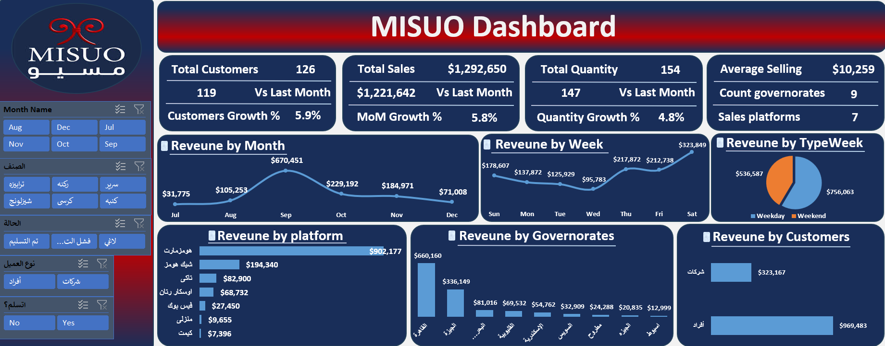
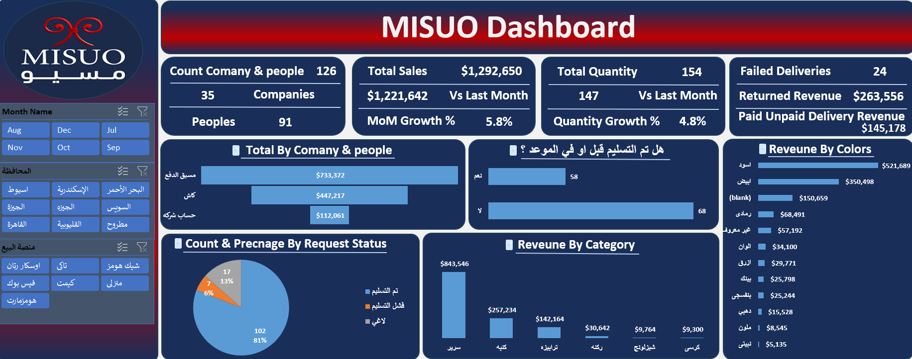

# 📊 MISUO Sales & Operations Analytics Dashboard

## 📌 Project Overview
An end-to-end Business Intelligence and Data Analytics project focused on transforming a highly unstructured, messy dataset for **"MISUO"** into a reliable, interactive two-page dashboard. The primary goal is to track sales performance, evaluate platform efficiency, and uncover operational delivery bottlenecks.

---

## 🖼️ Dashboard Preview

### Page 1: Executive Sales & Revenue Trends

### Page 2: Operations & Delivery Bottlenecks

*(Note: Make sure the uploaded image names match the names in the brackets above)*

---

## 🔍 Core Focus: Data Quality & Intensive Data Cleaning
The biggest challenge and primary achievement of this project was overcoming severe data quality issues in the raw dataset. Before any modeling or visualization could take place, an extensive data cleaning pipeline was executed using **Power Query**:
* **Data Cleaning & Standardization:** Resolved inconsistent text formatting, trimmed hidden spaces, handled missing/blank values, and standardized categorical names across sales platforms, governorates, and product categories.
* **Data Quality & Integrity Checks:** Audited and corrected faulty data types across all numeric and text fields (converting corrupted string values into accurate numeric formats) to prevent calculation errors and ensure 100% reporting accuracy.
* **Feature Engineering:** Built custom conditional logic to classify transaction dates into `Weekday` vs. `Weekend`, and structured status flags to monitor delivery SLA compliance.

---

## 📐 Data Modeling & Advanced DAX
* **Star Schema Architecture:** Generated a dedicated, continuous `Calendar Table` linked (1-to-Many) to the main transactional fact table to enable seamless Time-Intelligence analysis.
* **Executive KPIs:** Authored DAX measures for Total Sales (`$1,292,650`), Total Customers (`126`), Total Quantity (`154`), and Average Selling Price (`$10,259`).
* **Time-Intelligence (MoM %):** Implemented Month-over-Month growth tracking across sales (`+5.8%`), customers (`+5.9%`), and quantities (`+4.8%`).
* **Operational Risk Metrics:** 
  * `Failed Deliveries`: Tracked incomplete/returned shipments (`24 orders`).
  * `Returned Revenue`: Quantified total value of failed deliveries (`$263,556`).
  * `Paid Unpaid Delivery Revenue`: Highlighted critical financial risk from prepaid orders not yet delivered (`$145,178`).

---

## 💡 Key Business Insights
1. **Platform Dominance:** *Homzmart* leads sales volume overwhelmingly (`$902,177`), followed by *Chic Homz* (`$194,340`).
2. **Geographic Concentration:** *Cairo* (`$660,160`) and *Giza* (`$336,149`) account for the vast majority of revenue.
3. **Customer Segmentation:** Individual consumers (B2C) drive `$969,483` in sales compared to `$323,167` from corporate clients (B2B).
4. **Delivery SLA & Bottlenecks:** While `81%` of orders are successfully delivered, `13%` are canceled and `6%` fail delivery, with a significant portion missing the target delivery date (`68` delayed vs. `58` on-time), requiring immediate courier performance auditing.

---

## 🛠️ Tech Stack & Tools
* **Data Cleaning & ETL:** Power Query
* **Data Modeling & Calculations:** Power Pivot / Power BI (DAX)
* **Data Visualization & UI/UX:** Interactive Dashboards, Dynamic Slicers

---

## 📬 Contact & Connect
* **LinkedIn:** linkedin.com/in/abdallah-rady-747755436‏
